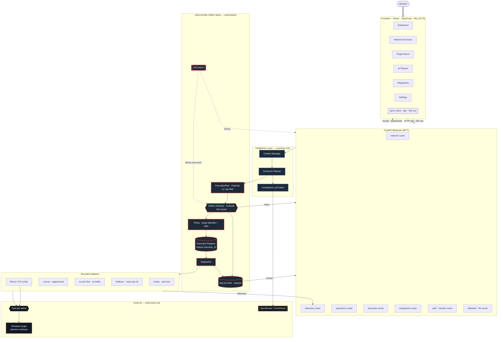

# AI RED TEAM

**An AI-assisted Red-Team-vs-Blue-Team security lab platform that runs entirely from Kali Linux.**

An operator drives a React dashboard; an LLM *proposes* bounded security assessments as structured plans; a deterministic Python backend *validates, authorizes, executes, and audits* them through a single fail-closed Safety Gateway. **The AI never invokes tools or makes authorization decisions** — it only suggests; the backend decides.

> Built for an authorized, isolated research lab. It is a demonstration/lab tool, not an internet-facing service and not a production security product.

---

## Why

An LLM that can run attack tools directly is dangerous: a hallucinated or manipulated plan could do real damage. AI RED TEAM addresses this by **separating three concerns**:

| Concern | Owner | Property |
|---|---|---|
| **Intelligence** | LLM planner (`app/agent/planner.py`) | proposes structured plans; no execution handle |
| **Authorization** | Safety Gateway (`app/safety/gateway.py`) | deterministic, fail-closed, AI-independent |
| **Execution** | Python adapters (`app/integrations/*`) | bounded, read-only or capped, audited |

The AI proposes, the backend validates and authorizes, the operator approves where required, and every action is recorded.

---

## Architecture



**Reading the diagram:** the **Intelligence Layer** (blue) only *proposes* a structured plan. The **Safety Spine** (red) is the authoritative, AI-independent chokepoint — a plan becomes an approved, registered execution only after `Safety Gateway → Policy → Registry`, and the **Kill Switch** can block the whole thing at the gateway or API edge. Only the **Dispatcher** reaches an **Adapter**, and only adapters touch the **External lab** (amber) over Tailscale. Everything is written to the **Audit** store.

**Execution lifecycle (gated path):** `Dashboard → FastAPI → AI Planner → ExecutionPlan → Safety Gateway → Execution Registry → Dispatcher → Adapter → Telemetry → Audit → Dashboard.`

- **Authorization** is enforced in `gateway.evaluate()` (and `authorize_recon_target()` for recon routes) — never in the frontend.
- **Kill switch** (`app/safety/killswitch.py`) is checked at the top of the gateway and on every network-touching route; reset requires `SAFETY_ADMIN_TOKEN` (no unauthenticated reset).
- **Audit** (`app/safety/audit.py`) persists every decision/result to SQLite with secrets masked.

> **Honest scope:** the gated pipeline above fully covers the **Hydra / Locust / NetExec** adapters and `/api/execution`, `/api/operations`. A few routes (`/api/telemetry/probe`, `/api/attacks/soc-activity`, `/api/assessment/run`, `/api/auth/live-validate`, `/api/transfer/send`) enforce **central authorization + kill-switch + audit** but are **not** yet unified into the Execution Registry pipeline. This is documented, not hidden.

---

## Request lifecycle — end to end

A concrete walkthrough of what happens when an operator runs an operation.

**A. Harmless reconnaissance (recon route):**

1. Operator enters an authorized target IP in **Target Recon** and clicks probe.
2. `api.ts` sends `POST /api/telemetry/probe {target}` to FastAPI.
3. The route checks the **kill switch** first (`423` if engaged).
4. `authorize_recon_target(target)` runs: valid IPv4? RFC1918 lab or current tailnet peer? public / loopback / shared-hotspot subnet → **refused, fail-closed**.
5. If authorized, `run_probe()` performs a **bounded TCP-connect** of the approved port set (conservative timeout, total budget).
6. The result (reachable? open ports? latency? or honest "unreachable") is returned, and a `RECON_PROBE` **audit** record is written.
7. The dashboard renders **measured** values — nothing fabricated; an offline host shows "unreachable", not fake open ports.

**B. Gated adapter operation (e.g. a Locust load test):**

1. Operator (or the AI planner) produces a structured **`ExecutionPlan`** — module, target, requested params. The plan has **no field that can set or raise a cap**.
2. `POST /api/integrations/locust/run` → `gateway.evaluate(plan)`.
3. The **Safety Gateway** checks, in order and fail-closed: kill switch → module enabled → adapter available → **target allowlist** → operation allowlist → **clamp params down to caps** → concurrency.
4. On approval it creates an **Execution Registry** record with a **unique `execution_id`** and transitions it `VALIDATING → APPROVED`.
5. The **Dispatcher** — the *only* path from an approved record to an adapter — sets the process context, runs the adapter, and advances the record `RUNNING → COMPLETED / FAILED / TIMED_OUT / CANCELLED`.
6. The adapter (headless subprocess, e.g. Locust) runs **bounded** (≤50 users / ≤120 s), and its real stats are parsed.
7. Milestones and the masked result are **audited**; telemetry streams to the dashboard over the WebSocket.
8. A rejected plan never gets an approved record, so it can **never** reach an adapter.

## Execution states

Every gated execution is tracked in the registry with a strict state machine (`app/safety/registry.py`):

| State | Meaning |
|---|---|
| `REQUESTED` | plan received |
| `VALIDATING` | passing through the gateway |
| `APPROVED` | authorized, registered with an `execution_id` |
| `RUNNING` | adapter executing (process attributed to this id) |
| `OBSERVING` | post-run analysis |
| `COMPLETED` / `FAILED` / `TIMED_OUT` | terminal outcomes |
| `CANCEL_REQUESTED` → `CANCELLED` | operator/kill-switch cancellation |
| `REJECTED` | gateway refused (no runnable record created) |

Invalid transitions raise `InvalidTransition`; a terminal state is never overwritten (a cancellation can't be clobbered by a late "completed").

## Design principles

- **AI proposes, the backend disposes.** The LLM only emits a validated plan; authorization, caps, and execution are deterministic and AI-independent.
- **Fail closed.** Any parse error, policy error, or ambiguity denies rather than allows.
- **Single chokepoint.** Gated modules share one Safety Gateway, one Execution Registry, one Dispatcher, one kill switch — no module-specific authorization.
- **Bounded capability.** Read-only operations where possible; hard caps a plan can only lower; no arbitrary shell, no flooding, no credential spraying.
- **Honest telemetry.** Measured vs simulated vs unavailable are always distinguished; missing data is "unavailable", never invented.
- **Secrets never travel.** Credentials live only in the gitignored `.env`, are masked in audit/API/exceptions, and are never placed in an LLM prompt.
- **Connectivity ≠ authorization.** Being reachable on the tailnet does not authorize testing; a target must pass central authorization.

---

## Modules

| Module | Tool | What it does | Status |
|---|---|---|---|
| **Network Discovery** | Tailscale + TCP | enumerate tailnet peers / bounded lab-subnet discovery; explicit target selection; **dynamic hotspot protection** | live-verified |
| **Reconnaissance** | agentless TCP-connect | bounded port/banner probe of an authorized target | live-verified |
| **Hydra** | `hydra` v9.7 | bounded authentication-resilience testing (attempt caps, lockout-aware) | mock-verified |
| **Locust** | `locust` 2.47 | capped HTTP load testing (≤50 users / ≤120 s) + a labeled **simulation** mode (no traffic) | mock + simulation |
| **NetExec** | `nxc` | 5 fixed **read-only** remote ops (connectivity_check / whoami / hostname / os_info / system_info) | implemented (not live-verified) |
| **Offline Hash Audit** | rockyou | dictionary audit of an authorized hash (masked output) | live-verified (local) |
| **File Transfer** | HTTP + SHA-256 | operator-controlled authenticated transfer with integrity check | implemented (receiver-dependent) |
| **Telemetry / UBA** | psutil / probe | host metrics, behavior scoring; measured vs simulated vs unavailable are labeled | mock-verified |

**Safety guarantees:** fail-closed target authorization (RFC1918 lab or tailnet peer only; public / loopback / shared-hotspot subnet rejected — the hotspot is detected *dynamically* from the live default route); per-module caps that a plan can only lower; a global kill switch; and an append-only audit trail. No flooding/amplification, no arbitrary shell, no credential spraying.

---

## Tech stack

Kali Linux · **FastAPI** + **Pydantic** (backend) · **React + TypeScript + Vite** (frontend) · **Tailscale** (lab connectivity) · **SQLite** (audit) · **OpenRouter** (LLM, optional **OmniRoute** gateway) · Hydra / Locust / NetExec.

## Repository layout

```
backend/app/
  agent/        AI planner, analysis, feedback, context
  safety/       gateway · policy · registry · dispatcher · killswitch · audit · plan_schema
  integrations/ hydra · locust · locust_sim · remote_access(netexec) · _llm
  services/     discovery · assessment · transfer · hash_audit · wordlist · availability
  telemetry/    collector (local/blackbox) · service
  api/          routers (network, telemetry, integrations, operations, execution, auth, transfer, llm, routes)
frontend/src/   pages (Dashboard, NetworkDiscovery, TargetRecon, AIPlanner, Integrations, Settings), components, api.ts
scripts/        start · stop · restart · health · smoke
docs/           architecture, module guides, demo runbook, final_demo/
```

---

## Setup & run (Kali)

The quickest path uses the helper scripts (see `docs/SERVER_RUNBOOK.md`):

```bash
./scripts/start.sh      # backend :8077 + frontend :5173
./scripts/health.sh     # verify both + backend health JSON
./scripts/restart.sh    # after editing backend/.env
```

Manual backend start (the venv interpreter is 3.14 but packages are under 3.13, so run with 3.13):

```bash
cd backend
PYTHONPATH="$PWD/.venv/lib/python3.13/site-packages" \
  /usr/bin/python3.13 -m uvicorn app.main:app --host 127.0.0.1 --port 8077
```

Configuration lives in the **gitignored** `backend/.env` (template: `backend/.env.example`; reference: `docs/ENVIRONMENT_VARIABLES.md`). Never commit secrets.

## Testing

```bash
make test        # backend: 252 passing (pytest, Python 3.13 invocation)
make typecheck   # frontend TypeScript
make build       # frontend production build
```

All tests are mocked/offline — no external attacks run in the suite.

## API

Full route reference: **`docs/api/ENDPOINTS.md`**. Key routes: `GET /api/health`, `POST /api/llm/test`, `POST /api/network/discovery/start`, `POST /api/network/targets/select`, `POST /api/telemetry/probe`, `POST /api/killswitch[/reset]`.

## Security notes

- Secrets only in gitignored `backend/.env` (mode 600); masked in audit/API/exceptions; never sent to the LLM.
- Tailscale connectivity is **not** authorization — a target must pass `authorize_recon_target()` / the gateway allowlist.
- Kill-switch reset requires `SAFETY_ADMIN_TOKEN`.

## Status & limitations

**READY WITH LIMITATIONS.** Live-verified: discovery, target authorization, recon, kill-switch, audit, local telemetry. Known limitations: some routes not yet Registry-unified; live NetExec/file-transfer require the Windows target online + an operator-started receiver; Windows *internal* telemetry is unavailable to an external probe (reported as such, never fabricated). See `docs/final_demo/LIMITATIONS_AND_FUTURE_SCOPE.md`.
