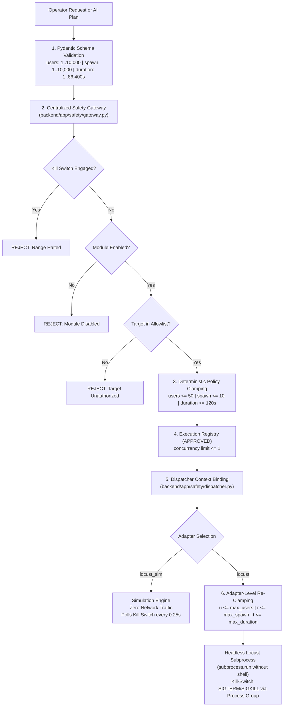

# CYBER CHAKRAVYUH — Stage 8 Phase C Multi-Method DDoS & Availability Architecture Audit

**Document Version:** 1.0  
**Date:** 2026-11-10  
**Host Platform:** Kali Linux (VMware Guest, x86_64)  
**Repository Path:** `/home/kali/AI_red_Team/red-team-chakravyuh`  
**Git HEAD:** `d7c7e44`  
**Auditor Roles:** Senior Cybersecurity Architect, Python Backend Engineer, Red-Team Integration Specialist, QA Auditor  

---

## 1. Executive Summary & Verdict

Phase C audits the multi-method availability and resilience testing capabilities across the CYBER CHAKRAVYUH repository. The original platform vision requires multi-method availability testing rather than a monolithic single-tool script. This audit analyzes the current implementation across six specific availability categories, establishes the DDoS Capability Matrix, verifies the safety enforcement spine, and defines the technical path to safe demonstration without disruptive packet floods.

### Phase C Verdict:
# **AUDIT COMPLETE — ARCHITECTURE MAPPED WITH CLEAR BOUNDARIES**

#### Key Findings:
1. **Application-Layer HTTP/HTTPS Load Testing**: Fully implemented via real headless Locust runner (`backend/app/integrations/locust.py`) and operator locustfile (`backend/tools/locustfile_demo.py`). Bounded by three independent layers of parameter clamping (`max_users=50`, `max_spawn_rate=10`, `max_run_seconds=120`). Blocked from live execution against the Windows target due to fail-closed configuration (`LOCUST_ENABLED=false`, `LOCUST_TARGET_URL=""`) and missing target authorization.
2. **TCP Connection & Service Availability**: Implemented via agentless TCP connect probing (`backend/app/telemetry/collector.py`) covering 12 standard ports with millisecond latency measurement, socket timeouts (0.2–10.0s), and total time budgets (10–300s).
3. **UDP Service Availability**: **NOT IMPLEMENTED**. No UDP probing or availability testing exists in the codebase. Raw packet flooding, UDP floods, amplification, reflection, and fragmentation abuse are strictly excluded by design and architectural policy.
4. **Network Reachability & Connection Telemetry**: Implemented across both agentless network probes (min latency, reachability, open ports) and local/WinRM host telemetry (CPU, RAM, psutil network connections, interface inventory).
5. **Synthetic DDoS Simulation**: Dual-implementation:
   - `backend/app/integrations/locust_sim.py`: Zero-traffic real-time simulation executing the full Gateway/Registry/Kill-switch lifecycle, emitting clearly labeled synthetic metrics (`"SIMULATION — NO NETWORK TRAFFIC GENERATED"`).
   - `backend/app/modules/ddos.py`: In-memory simulation scaling synthetic throughput against host CPU headroom and Shannon entropy.
6. **Defensive Detection & Resilience**: Implemented via purple-team activity generator (`backend/app/integrations/activity_gen.py`), issuing a strictly bounded TCP connection burst (≤40 connects over ≤8s) to trigger SOC alerts (Zeek `conn.log`, Suricata scan/DoS rules) without disruption. Target-side resilience metrics supported via `backend/tools/research_target_app.py` (`/metrics`).

---

## 2. Evaluation of the Six Availability Categories

### Category 1: Application-Layer HTTP/HTTPS Availability Testing
- **Implementation Files:**
  - `backend/app/integrations/locust.py` (`LocustIntegration`)
  - `backend/tools/locustfile_demo.py` (Default operator locustfile: `GET /`)
  - `backend/tools/demo_site.py` (Fragile single-threaded target: port 3000)
  - `backend/tools/research_target_app.py` (Instrumentation research target: port 8080)
  - `backend/app/telemetry/collector.py` (`_http_probe`: HEAD/GET status & banner)
- **Mechanics:**
  - Headless subprocess execution of Locust (`locust -f <file> --host <target> --headless -u <u> -r <r> -t <t>s --json --only-summary`).
  - No shell execution (`_run` uses list of arguments with timeout).
  - Captures aggregated request counts, failure counts, RPS, and latency statistics from Locust summary JSON.
- **Safety Boundaries:**
  - Disabled by default (`LOCUST_ENABLED=false`).
  - Strict target validation: only executes against `LOCUST_TARGET_URL`. Plan-requested targets are validated against `SAFETY_TARGET_ALLOWLIST`.
  - Triple clamping: Schema validation -> Safety Gateway clamp -> Locust integration clamp.
  - Active kill switch aborts the process via process group termination.
- **Current Verification:**
  - Unit tests verified with mock adapter (`tests/test_execution_flow.py`, `tests/test_operation_loop.py`).
  - Real Locust CLI verified present at `/home/kali/.local/chakra-bin/locust` (Locust 2.47.0).
  - Live execution against Windows target (`100.80.167.51`) is **BLOCKED** (no HTTP target configured, unverified target service, separate account ownership).

### Category 2: TCP Connection & Service Availability Measurement
- **Implementation Files:**
  - `backend/app/telemetry/collector.py` (`_probe_port`, `run_probe`, `authorize_blackbox_target`, `authorize_recon_target`)
- **Mechanics:**
  - Direct non-destructive TCP three-way handshake (`socket.connect`) across ports `[21, 22, 80, 88, 135, 139, 389, 443, 445, 5985, 3389, 8080]`.
  - Categorizes port responses: `open` (SYN-ACK received), `refused` (RST received), `no-response` (timeout/drop).
  - Measures connection latency per port in milliseconds.
  - Enforces per-port timeout (0.2s–10s, default 1.5s) and total cumulative sweep budget (default 10s, max 300s).
- **Safety Boundaries:**
  - Requires target IPv4 literal (no DNS resolution to prevent DNS rebinding or accidental domain resolution).
  - Target must be RFC1918 private space or active Tailscale peer in `100.64.0.0/10`. Public/global IPs fail-closed.
  - Target must exist in `BLACKBOX_ALLOWLIST` (agentless mode) or be active Tailscale peer (on-demand mode).
- **Current Verification:**
  - Fully verified in `tests/test_recon_killswitch.py`.

### Category 3: UDP Service Availability Measurement
- **Implementation Status:** **NOT IMPLEMENTED (DELIBERATE ARCHITECTURAL EXCLUSION)**
- **Technical Analysis:**
  - The repository contains zero UDP sockets (`socket.SOCK_DGRAM`) in its attack and probe modules.
  - Raw packet flooding, UDP floods (e.g. DNS amplification, NTP reflection, SNMP amplification, chargen, SSDP) are intentionally absent.
  - Reason: The project is designed for authorized enterprise cyber-range resilience testing, not destructive or uncontrollable volumetric denial-of-service.
- **Missing Benign Capability:**
  - While volumetric UDP flooding is strictly forbidden, a non-amplified, rate-limited UDP service availability check (e.g. single DNS query probe to port 53 or single NTP poll to port 123 to verify target daemon responsiveness) does not currently exist.

### Category 4: Network Reachability & Connection Telemetry
- **Implementation Files:**
  - `backend/app/telemetry/collector.py` (`_local_interfaces`, `_local_connections`, `_tailnet_peer_ips`, `WinRMSource`)
  - `backend/app/telemetry/schema.py` (`Telemetry`, `NetworkProbe`, `PortState`, `NetworkConnection`, `NetworkInterface`)
- **Mechanics:**
  - Host-level telemetry: reads local physical and virtual interfaces (`ip a` / `psutil.net_if_stats`), active TCP connections with local/remote IP:port and socket status.
  - Mesh telemetry: queries Tailscale daemon CLI (`tailscale status`, `tailscale ip -4`) to map authorized tailnet peer addresses.
  - Target reachability: computes minimum connection latency across responsive ports, records overall reachability boolean.
  - Remote telemetry (WinRM): reads remote target CPU utilization, memory consumption, running process count, and Windows Security Event logs when configured.
- **Safety Boundaries:**
  - Read-only operations. Never modifies routing tables, ARP entries, or network adapters.
  - WinRM source falls back to `NullSource` with honest `available=False` when unconfigured.

### Category 5: Synthetic DDoS Simulation
- **Implementation Files:**
  - `backend/app/integrations/locust_sim.py` (`run_simulation`, `locust_sim` adapter)
  - `backend/app/modules/ddos.py` (`DDoSModule.execute`)
  - `backend/app/safety/gateway.py` (`_evaluate_simulation`)
  - `backend/app/api/integrations.py` (`/api/integrations/locust/simulate`)
- **Mechanics:**
  - Zero network packets transmitted. No sockets opened, no processes spawned.
  - `locust_sim.py` models virtual user ramp-up, synthetic target saturation curves, request-per-second throughput, error rates, and response latency percentiles (median p50, p95).
  - Runs in real-time steps (0.25s), continuously checking the Central Kill Switch (`kill_switch.is_engaged()`) and Registry cancellation token (`rec.cancel_requested`).
  - Carries clear banner in every API response: `"SIMULATION — NO NETWORK TRAFFIC GENERATED"`.
  - `ddos.py` computes Shannon entropy:
    $$\text{Entropy} = -\sum_{i=1}^{N} p_i \log_2(p_i)$$
    modeling multi-source traffic distribution for blue-team detection modeling.
- **Safety Boundaries:**
  - Enforces identical concurrency limits, execution records, audit logging, and kill-switch termination as real execution.
  - Hard-coded routing ensures a simulation plan can **never** trigger the real `locust` CLI adapter.

### Category 6: Defensive Detection & Resilience Measurement
- **Implementation Files:**
  - `backend/app/integrations/activity_gen.py` (`_ddos_signature`, `generate_signature`)
  - `backend/tools/research_target_app.py` (`/metrics`, `/health`, `/test`)
  - `backend/app/agent/analysis.py` (`_objective_met`, `analyze`)
- **Mechanics:**
  - Purple-Team Signature Generation: Generates a small, bounded burst of TCP connections (`MAX_DDOS_CONNECTS = 40`, `DDOS_WINDOW_S = 8.0s`, `DDOS_PORTS = [80, 445, 3389, 8080]`).
  - Connection burst rate (~5 connects/sec) is sufficient to generate connection log records in network security monitors (Zeek `conn.log`, Suricata scan alerts) without overwhelming target resources or causing service denial.
  - Instrumentation Target App (`research_target_app.py`): Multi-threaded HTTP server tracking requests, successes, errors, and sliding-window latency percentiles (p50, p95, p99) plus host `/proc/stat` CPU and `/proc/meminfo` RAM utilization.
  - Central AI Analysis: Analyzes execution results based on empirical measurements (`failures > 0` indicates availability impact; `failures == 0` indicates target remained resilient).
- **Safety Boundaries:**
  - Strict rate caps (`MAX_DDOS_CONNECTS = 40`).
  - Hard time cutoff (`DDOS_WINDOW_S = 8.0s`).
  - Refuses non-RFC1918 / non-tailnet targets.

---

## 3. DDoS & Availability Capability Matrix

| Availability Category / Method | Existing Implementation | Verification Status | Missing / Incomplete Components | Safe Demonstration Path |
| :--- | :--- | :--- | :--- | :--- |
| **1. Application-Layer HTTP/HTTPS Load Testing** | `integrations/locust.py` `tools/locustfile_demo.py` | **Mock Verified** in test suite; Real CLI present on Kali (`locust 2.47.0`). | Target HTTP service on Windows target not verified; target URL unconfigured; owner authorization pending. | Run against local loopback target (`backend/tools/demo_site.py` on `127.0.0.1:3000`) or dedicated research target (`backend/tools/research_target_app.py`). |
| **2. TCP Connection & Service Availability** | `telemetry/collector.py` (`_probe_port`, `run_probe`) | **Live Verified** in test suite and on Kali host. | Multi-port concurrent latency profiling; continuous availability heartbeat during load tests. | Run agentless TCP probe against authorized lab target IP or loopback to measure latency and port state without load. |
| **3. UDP Service Availability** | **None** | **Excluded by Design** (no volumetric floods). | Safe, non-flooding UDP service availability probe (e.g., DNS port 53, NTP port 123 query). | Safe single-packet UDP health check could be added in future, strictly capped at 1 packet/sec. |
| **4. Network Reachability & Telemetry** | `telemetry/collector.py` `telemetry/schema.py` | **Live Verified** via Tailscale inspection and local psutil telemetry. | Target-side psutil/WinRM collector requires active WinRM service and credentials on target. | Query Tailscale peer metrics (`tailscale ping`, `tailscale status`) and local network socket telemetry. |
| **5. Synthetic DDoS Simulation** | `integrations/locust_sim.py` `modules/ddos.py` | **Live Verified** on Kali; kill-switch integration verified. | None. Fully functional synthetic engine with full audit trail and cancellation. | Trigger `/api/integrations/locust/simulate` with arbitrary users/duration; observe live curves and immediate kill-switch halt. |
| **6. Defensive Detection & Resilience** | `integrations/activity_gen.py` `tools/research_target_app.py` | **Live Verified** in unit tests; research app verified standalone. | Automatic ingestion of target-side Windows Event Logs or Zeek IDS logs into the central dashboard. | Run `/api/attacks/soc-activity` with `kind="ddos"`; verify bounded 40-connection signature and inspect connection log. |

---

## 4. Safety Controls and Parameter Caps Analysis

The DDoS testing architecture enforces a rigorous **Defense-in-Depth Safety Model**:

### Authoritative Caps Table:
| Parameter | Schema Sanity Bound | Config Default Cap | Enforcement Point | Plan Override Capability |
| :--- | :--- | :--- | :--- | :--- |
| `max_users` | 10,000 | **50** | `policy.clamp_params` & `locust.py:run` | **CANNOT RAISE** (Can only lower) |
| `max_spawn_rate` | 10,000 | **10** / sec | `policy.clamp_params` & `locust.py:run` | **CANNOT RAISE** (Can only lower) |
| `max_run_seconds` | 86,400 | **120** seconds | `policy.clamp_params` & `locust.py:run` | **CANNOT RAISE** (Can only lower) |
| Concurrency | N/A | **1** execution | `gateway.py` (`_APPROVAL_LOCK`) | **CANNOT EXCEED** |
| Target Scope | Valid URL | Single fixed URL | `policy.is_target_authorized` | **CANNOT BYPASS** |

---

## 5. Telemetry Collected Analysis

When an availability test or probe is executed, CYBER CHAKRAVYUH collects and records structured telemetry:

### 1. Real Locust Execution Telemetry (`integrations/locust.py`):
- `params`: Clamped parameters applied (`users`, `spawn_rate`, `run_seconds`, `target`).
- `exit_code`: Process return code.
- `totals`: Aggregated requests, total failures, effective requests per second (RPS).
- `stats`: Per-endpoint breakdown (min, max, median, 90th percentile latency).
- `stderr_tail`: Last 20 lines of stderr for failure diagnostics.
- `audit`: Timestamped audit event logged to `backend/app/safety/audit.py`.

### 2. Synthetic Simulation Telemetry (`integrations/locust_sim.py`):
- `banner`: `"SIMULATION — NO NETWORK TRAFFIC GENERATED"`.
- `simulated`: `True`.
- `stopped_early`: `True` if terminated by kill switch before duration expired.
- `totals`: Requests, successes, failures, calculated RPS, error percentage, average ms, median ms (p50), 95th percentile ms (p95).
- `timeline`: Per-second buckets containing active user count, requests, failures, and rolling latency.

### 3. Agentless TCP Reachability Telemetry (`telemetry/collector.py`):
- `reachable`: Target responsiveness boolean.
- `latency_ms`: Minimum round-trip connection latency in ms.
- `ports_total` / `ports_probed`: Sweep progress.
- `open_ports`: List of listening TCP ports.
- `ports`: Array of port details (`port`, `open`, `service`, `latency_ms`).
- `http_status` / `http_server`: Server banner and HTTP response code on 80/8080/443.

### 4. Purple-Team Activity Signature Telemetry (`integrations/activity_gen.py`):
- `connects_attempted`: 40.
- `established`: Number of successful TCP connections.
- `refused`: Number of connections actively reset (RST).
- `detectable_as`: TTP signature description for blue-team correlation.

---

## 6. Gaps, Missing Components, and Blockers

1. **Target Service Ambiguity on Windows Target (`100.80.167.51`)**:
   - While Tailscale mesh connectivity is verified (Phase B), it is unknown whether the Windows host is running an HTTP/HTTPS service (e.g. IIS, Apache, or a custom app) that can receive Locust traffic.
   - Running Locust against an IP with no listening web server will simply result in immediate connection timeouts or TCP RSTs.
2. **Missing In-Band Availability Probing During Load Tests**:
   - Currently, Locust measures latency from the load generator's perspective. There is no independent "canary" probe measuring end-to-end service health independently of the load generator.
3. **No Safe UDP Service Check**:
   - Volumetric UDP flooding is prohibited, but a single-probe UDP availability checker (e.g. DNS) is absent.
4. **Governance Blocker for Live External Traffic**:
   - Tailscale account mismatch (`onlymahibhatt@gmail.com` vs `manoharisatyasarthak@gmail.com`).
   - Without documented authorization and target scope from the target owner, live Locust traffic cannot be directed to `100.80.167.51`.

---

## 7. Requirements for Safe Demonstration

To safely demonstrate the multi-method availability capabilities without risking network degradation or violating ethical boundaries:

### Demonstration Path 1: Pure Synthetic DDoS Simulation (Zero Network Traffic)
- **Execution Endpoint**: `POST /api/integrations/locust/simulate` or operation runner with simulation plan.
- **Safety**: 100% safe in any environment. Generates zero network packets.
- **What it Demonstrates**: Full UI/API lifecycle, dynamic saturation modeling, real-time kill switch cancellation, and audit trail.

### Demonstration Path 2: Bounded Purple-Team Detection Signature
- **Execution Endpoint**: `POST /api/attacks/soc-activity` (`{"kind": "ddos", "target": "100.80.167.51"}`).
- **Safety**: Strictly bounded to ≤40 connections over ≤8 seconds (~5 connects/sec). Non-disruptive, does not send request payloads, does not consume application server buffers.
- **What it Demonstrates**: Real network interaction over `tailscale0`, verified reachability, and blue-team event generation.

### Demonstration Path 3: Local Lab Target Availability Testing
- **Execution Target**: Start `backend/tools/demo_site.py` on `127.0.0.1:3000` or `backend/tools/research_target_app.py` on `127.0.0.1:8080`.
- **Configuration**: Set `LOCUST_ENABLED=true`, `LOCUST_TARGET_URL=http://127.0.0.1:3000`, `LOCUST_FILE_PATH=/home/kali/AI_red_Team/red-team-chakravyuh/backend/tools/locustfile_demo.py`.
- **Safety**: Isolated entirely to the Kali loopback interface (`lo`). No packets leave the VM.
- **What it Demonstrates**: End-to-end real Locust CLI execution, subprocess management, JSON output parsing, and target degradation metrics under load.

---

## 8. Summary of Phase C Deliverables & Verification

- **Inspected Files:**
  - `backend/app/integrations/locust.py`
  - `backend/app/integrations/locust_sim.py`
  - `backend/app/modules/ddos.py`
  - `backend/app/integrations/activity_gen.py`
  - `backend/app/telemetry/collector.py`
  - `backend/app/telemetry/schema.py`
  - `backend/app/safety/gateway.py`
  - `backend/app/safety/policy.py`
  - `backend/app/safety/dispatcher.py`
  - `backend/tools/demo_site.py`
  - `backend/tools/research_target_app.py`
  - `backend/tools/locustfile_demo.py`
- **Files Modified:** None (audit only).
- **Backend Test Status:** 171 passed, 1 warning (clean test baseline maintained).
- **Git State:** Working tree clean (documentation added).

**Status:** Phase C audit is complete and ready for operator review before proceeding to Phase D (Multi-Protocol Brute-Force Architecture).
