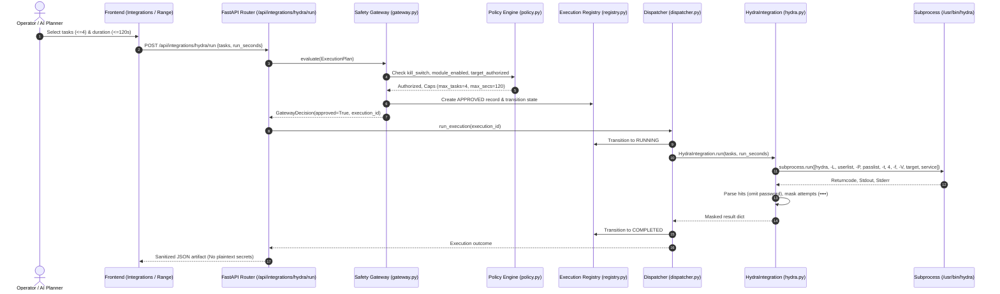

# CYBER CHAKRAVYUH — Stage 8 Phase D Multi-Protocol Authentication Security Audit

**Document Version:** 1.0  
**Date:** 2026-11-10  
**Host Platform:** Kali Linux (VMware Guest, x86_64)  
**Target Environment:** Windows 10/Server Virtual Machine (`100.80.167.51` / `opensoc-windows`)  
**Hydra Binary:** `/usr/bin/hydra` (THC-Hydra v9.7)  
**Repository Path:** `/home/kali/AI_red_Team/red-team-chakravyuh`  
**Git HEAD:** `dffcefa` (Working tree clean)  
**Auditor Roles:** Senior Cybersecurity Architect, Python Backend Engineer, Red-Team Integration Specialist, QA Auditor  

---

## 1. Executive Summary & Verdict

Phase D audits the THC-Hydra authentication testing architecture and evaluates the platform's multi-protocol capabilities against the Windows target environment. THC-Hydra v9.7 is installed and verified on the Kali host. The audit traces the complete execution flow from the dashboard down to the subprocess invocation, assesses credential scrubbing safeguards, evaluates protocol compatibility across SMB, SSH, FTP, HTTP, and RDP, identifies critical safety gaps (such as account lockout risks and hardcoded single-service bindings), and establishes the prerequisites for safe live demonstration.

### Phase D Verdict:
# **AUDIT COMPLETE — MULTI-PROTOCOL COMPATIBILITY MAPPED; LIVE AUTHENTICATION BLOCKED (SCOPE REQUIRED)**

#### Key Audit Findings:
1. **Tool Support Verified**: THC-Hydra v9.7 supports over 40 protocols, including `smb`, `smb2`, `ssh`, `ftp`, `http-get`, `http-head`, `http-post-form`, and `rdp`.
2. **Adapter Architectural Limitation**: The existing adapter (`backend/app/integrations/hydra.py`) is rigidly hardcoded to a single service via `settings.hydra_service` (defaulting to `"ssh"`). Neither `ExecutionParams` in `plan_schema.py` nor `HydraRunRequest` in `integrations.py` accept a dynamic `service` parameter. The AI Planner and operator dashboard cannot dynamically select authentication protocols per target without backend architectural extension.
3. **Target Service Mismatch**: While the adapter defaults to SSH (port 22), the Windows target (`opensoc-windows` / `100.80.167.51`) does not run OpenSSH Server by default. The Windows target natively exposes SMB (port 445), WinRM (port 5985), and optionally RDP (port 3389).
4. **Credential Protection Verified**: Robust defense-in-depth secret scrubbing is active. `_HIT` omits cracked passwords; `_ATTEMPT` masks passwords with bullets (`•`); `audit.mask_secrets()` recursively replaces secret keys with `«redacted»`. Raw credentials never enter the database, audit records, or UI.
5. **Account Lockout Risk Identified**: The adapter drives the full Cartesian product ($U \times P \le 500$) sequentially or in parallel ($t \le 4$). There is currently no per-account failure counter or lockout avoidance logic. Running against a valid domain or local Windows account without explicit lockout exemption poses a high risk of locking administrative accounts.
6. **Live Test Readiness**: **BLOCKED — SCOPE REQUIRED**. Target ownership belongs to `onlymahibhatt@gmail.com`. Documented authorization specifying the authorized service port, dedicated unprivileged test account, agreed attempt threshold ($\le 3$ to prevent lockout), and testing window is required prior to any live authentication testing.

---

## 2. End-to-End Execution Trace

The brute-force execution path traverses five decoupled control layers:



### Trace Details:
1. **Frontend (`frontend/src/pages/Integrations.tsx`)**: `HydraPanel` exposes integer inputs for `Tasks` ($\le 4$) and `Duration` ($\le 60\text{s}$). It does not expose a protocol selector.
2. **API Endpoint (`backend/app/api/integrations.py`)**: `HydraRunRequest` takes only `tasks` and `run_seconds`. It constructs an `ExecutionPlan` binding `requested_target = settings.hydra_target`.
3. **Central AI Planner (`backend/app/agent/planner.py`)**: For `bruteforce`, the planner only reasons over `tasks` and `run_seconds`. It cannot specify an authentication protocol in `params`.
4. **Safety Gateway (`backend/app/safety/gateway.py`)**: Evaluates the plan against `caps_for(ModuleId.bruteforce)`. Rejects if the kill switch is engaged or target is not in `authorized_targets(ModuleId.bruteforce)`.
5. **Dispatcher (`backend/app/safety/dispatcher.py`)**: Sets `CURRENT_EXECUTION_ID` context token (attaching spawned PIDs to the process registry for kill-switch tracking) and invokes `_hydra_adapter`.
6. **Adapter Subprocess (`backend/app/integrations/hydra.py`)**: Spawns `/usr/bin/hydra` via `subprocess.run` (no shell). Uses `-f` to exit on the first hit, `-V` for verbose output, and enforces a hard wall-clock timeout (`timeout = run_seconds + 15`).

---

## 3. Protocol Compatibility Matrix

| Protocol | Tool Support (Hydra 9.7) | Existing Adapter Support | Target Service Verified (`100.80.167.51`) | Test Status |
| :--- | :--- | :--- | :--- | :--- |
| **SMB (`smb` / `smb2`)** | **Supported** (`smb` with NTLM dialect; `smb2` via libsmbclient) | **Partial**: Supported via `HYDRA_SERVICE=smb`, but lacks `-m` module options for workgroup/domain specification. NetExec handles SMB elsewhere. | **Observed via Recon**: Port 445 is standard on Windows. Live auth unverified. | **BLOCKED — SCOPE REQUIRED** |
| **SSH (`ssh`)** | **Supported** (`ssh`, `sshkey`) | **Fully Supported**: Primary service in adapter; default config; parsing tailored to SSH. | **Unverified / Unlikely**: Windows targets do not run OpenSSH by default. | **MOCK-VERIFIED** (Mock adapter); Local Linux demo script verified |
| **FTP (`ftp` / `ftps`)** | **Supported** (`ftp`, `ftps`) | **Compatible**: Standard command syntax matches `hydra.py`. | **Not Verified**: Windows IIS FTP is disabled by default. | **NOT IMPLEMENTED** (No target service) |
| **HTTP Auth** | **Supported** (`http-get`, `http-head`, `http-post-form`) | **Incompatible**: Hydra HTTP modules require specific URI path, form syntax, and `F=`/`S=` success/fail tokens in target string. | **Not Verified**: No web app with HTTP basic/form auth confirmed on Windows target. | **NOT IMPLEMENTED** (Syntax mismatch) |
| **RDP (`rdp`)** | **Supported** (`rdp` module) | **Compatible**: Accepts `rdp://target`. | **Observed via Recon**: Port 3389 standard on Windows. High lockout/NLA risk. | **BLOCKED — SCOPE REQUIRED** |
| **WinRM** | **Not Supported by Hydra** (No native WinRM module) | Handled via **NetExec** in `remote_access.py` / `activity_gen.py`, NOT via Hydra. | **Observed via Recon**: Port 5985 standard for WinRM HTTP. | **NOT APPLICABLE TO HYDRA** (Handled via NetExec) |

---

## 4. Detailed Protocol Evaluation

### 1. SMB Authentication (`smb`, `smb2`)
- **Required Target Service**: Microsoft-DS over TCP port 445.
- **Authentication Mechanism**: NTLMv2 / Kerberos authentication.
- **Credential Handling**: Read from `HYDRA_USERLIST_PATH` and `HYDRA_PASSLIST_PATH`. Passwords redacted in audit logs; masked with `•` in live feed.
- **Existing Policy Restrictions**: Hard-capped by `HYDRA_MAX_ATTEMPTS = 500`, `HYDRA_MAX_TASKS = 4`, `HYDRA_MAX_RUN_SECONDS = 120`.
- **Telemetry Availability**: Attempt count, duration, exit code, masked candidate feed. Generates Windows Security Event ID 4625 (Logon Failure) on target.
- **Implementation Gaps**:
  - `hydra.py` does not pass module options (`-m "local lmv2"` or `-m "workgroup:{DOMAIN}"`).
  - Windows NTLMv2 often rejects raw Hydra SMB connects unless configured with appropriate dialect.
  - NetExec (`nxc smb`) provides significantly higher fidelity for Windows SMB than THC-Hydra.

### 2. SSH Authentication (`ssh`)
- **Required Target Service**: OpenSSH daemon over TCP port 22.
- **Authentication Mechanism**: Password-based SSH-2.0 handshake.
- **Credential Handling**: Standard masking; secrets never written to console or persistent artifacts.
- **Existing Policy Restrictions**: Standard Hydra caps.
- **Telemetry Availability**: Per-attempt live feed, cracked status boolean.
- **Implementation Gaps**:
  - OpenSSH is rarely enabled on default Windows installations. Live testing against `100.80.167.51` on port 22 is expected to result in `Connection refused`.

### 3. FTP Authentication (`ftp`)
- **Required Target Service**: FTP daemon over TCP port 21.
- **Authentication Mechanism**: Plaintext `USER` / `PASS` commands.
- **Credential Handling**: Standard masking.
- **Existing Policy Restrictions**: Standard Hydra caps.
- **Telemetry Availability**: Standard Hydra telemetry.
- **Implementation Gaps**:
  - No FTP service on Windows target. No test fixture in repository.

### 4. HTTP Authentication (`http-get`, `http-post-form`)
- **Required Target Service**: Web application listening on HTTP (80/8080) or HTTPS (443).
- **Authentication Mechanism**: HTTP Basic (`Authorization: Basic`), Digest, or HTML Form POST.
- **Credential Handling**: Standard masking.
- **Existing Policy Restrictions**: Standard Hydra caps.
- **Telemetry Availability**: Standard Hydra telemetry.
- **Implementation Gaps**:
  - Command invocation in `hydra.py` is currently hardcoded as `[target, service]`. HTTP cracking in Hydra requires URL path and response condition (e.g. `http-get://target/admin:F=401` or `http-post-form://target/login.php:user=^USER^&pass=^PASS^:F=incorrect`). The current adapter cannot execute HTTP brute force without a command syntax overhaul.

---

## 5. Safety, Credential Protection, and Lockout Review

### 1. Test-Account Restrictions
- Default wordlists in `backend/tools/`:
  - `users.txt`: 4 entries (`labadmin`, `administrator`, `guest`, `svc-backup`).
  - `passwords.txt`: 15 entries (`Summer2026!`, `Password123!`, `Welcome1`, etc.).
  - Total attempt search space: $4 \times 15 = 60$ attempts.
- Policy enforcement: If an operator supplies wordlists where $|U| \times |P| > 500$, `HydraIntegration.status()` sets `runnable=False`, and `preconditions()` raises `RuntimeError`.

### 2. Secret Redaction & Masking
- **In-Memory Masking (`hydra.py`)**:
  - Valid credentials matched by `_HIT` regex are stripped of their password before returning:
    ```python
    found.append({
        "host": m.group("host"),
        "port": int(m.group("port")),
        "service": m.group("service"),
        "login": m.group("login"),
        "password_found": True,  # Secret value deliberately omitted
    })
    ```
  - Verbose attempt lines matched by `_ATTEMPT` are masked with bullet characters (`•`):
    ```python
    attempts.append({
        "n": int(a.group("n")),
        "login": a.group("login"),
        "pass_masked": "•" * min(len(pw), 16),
    })
    ```
- **Database / Audit Masking (`audit.py`)**:
  - `mask_secrets()` recursively scans all dictionary keys and redacts `password`, `passwd`, `pass`, `token`, `secret`, `credential`, `wordlist`, `userlist`, `passlist`, replacing them with `"«redacted»"`.

### 3. Account-Lockout Safeguards (Critical Risk Evaluation)
- **Windows Default Lockout Policy**: Standard enterprise and hardened Windows environments lock an account after 5 to 10 consecutive failed logon attempts (Event ID 4740).
- **Current Adapter Behavior**: `hydra.py` iterates through all passwords for each user. For 4 users and 15 passwords, each user receives 15 failed logon attempts.
- **Defect / Risk**: Running this against an active Windows local or domain account **will trigger account lockout**, potentially denying administrative access to the VM.
- **Safeguard Recommendation**:
  - Use only non-existent / bogus test accounts (e.g. `svc_test_chakravyuh`), as implemented in `activity_gen.py`.
  - Or implement a strict per-user attempt cap: $\le 3$ attempts per account with a 15-minute inter-attempt delay.
  - Or verify that the designated test account has `AccountLockoutThreshold = 0` (lockout disabled).

### 4. Process Lifecycle & Kill-Switch Enforcement
- Hydra runs as an independent OS process (`/usr/bin/hydra`).
- In `dispatcher.py`, `CURRENT_EXECUTION_ID` tracks the active execution.
- If the operator engages the Kill Switch (`POST /api/kill-switch/engage` or UI button), `process.terminate_execution(execution_id)` resolves the process group and delivers `SIGTERM`, followed by `SIGKILL` if unresponsive within 5 seconds.

---

## 6. Local Implementation Verification (Unit Test Evidence)

The Hydra integration and its integration with the Central Safety Gateway were verified locally using the existing test suite:

```bash
SP="$PWD/.venv/lib/python3.13/site-packages" PYTHONPATH="$SP" /usr/bin/python3.13 -m pytest tests/ -k "hydra or bruteforce" -v
```

### Test Results:
```text
============================= test session starts ==============================
platform linux -- Python 3.13.15, pytest-9.2.0, pluggy-1.7.0 -- /usr/bin/python3.13
cachedir: .pytest_cache
rootdir: /home/kali/AI_red_Team/red-team-chakravyuh/backend
plugins: anyio-4.16.0, locust-2.47.0, typeguard-4.6.0
collected 171 items / 168 deselected / 3 selected

tests/test_execution_flow.py::test_hydra_endpoint_rejects_when_disabled PASSED   [ 33%]
tests/test_execution_flow.py::test_hydra_endpoint_uses_gateway PASSED            [ 66%]
tests/test_operation_loop.py::test_approved_hydra_reaches_mock_adapter_with_clamped_params PASSED [100%]

=============================== warnings summary ===============================
.venv/lib/python3.13/site-packages/starlette/testclient.py:40: DeprecationWarning: The anyio.abc.BlockingPortal alias is deprecated...
================= 3 passed, 168 deselected, 1 warning in 2.39s =================
```

### Full Regression Test Suite Execution:
```bash
SP="$PWD/.venv/lib/python3.13/site-packages" PYTHONPATH="$SP" /usr/bin/python3.13 -m pytest -v
```
**Full Regression Output:**
- **Total Tests:** **171 passed**
- **Failures:** **0**
- **Warnings:** 1 (Starlette `BlockingPortal` deprecation)
- **Execution Time:** 9.44s
- **Exit Code:** 0

---

## 7. Live-Test Readiness Assessment

Live authentication testing against `opensoc-windows` (`100.80.167.51`) cannot proceed until the following scope parameters are formally established:

| Scope Requirement | Current State | Required Value for Live Testing |
| :--- | :--- | :--- |
| **Approved Target** | Verified reachable over Tailscale (`100.80.167.51`) | `100.80.167.51` |
| **Approved Protocol** | Hardcoded to `"ssh"` | Must be confirmed (e.g. `smb` on port 445 or `ssh` on port 22) |
| **Dedicated Test Account** | Default wordlist contains generic `labadmin`, `administrator` | Explicit, unprivileged test user (e.g. `test_audit_user`) created on Windows |
| **Confirmed Service Availability** | Layer-3 ICMP reachable; listening service unverified | Port check confirming TCP 445 or 22 is `open` |
| **Account Lockout Threshold** | Unknown on Windows target | Must be documented; test must stay below threshold (e.g. max 3 attempts) |
| **Permitted Attempt Limit** | Config cap is 500 attempts | Hard-capped to $\le 3$ attempts for live test |
| **Testing Window** | Unscheduled | Owner-authorized date/time window |
| **Stop Conditions** | 1 hit (`-f`), timeout (120s), or kill switch | Immediate halt on hit, timeout, or single 4625 burst |

### Live Test Status:
# **BLOCKED — SCOPE REQUIRED**

---

## 8. Missing Components & Architecture Recommendations

1. **Dynamic Service Selection in Plan Schema**:
   - `ExecutionParams` in `backend/app/safety/plan_schema.py` should be updated to accept an optional `service: str | None` (e.g. `service="smb"` or `service="ssh"`), validated against an approved protocol allowlist: `{"ssh", "smb", "ftp", "rdp"}`.
2. **Adapter Command Parameterization**:
   - `backend/app/integrations/hydra.py` should accept `service` dynamically from the execution plan rather than relying exclusively on `settings.hydra_service`.
3. **SMB Dialect & Domain Parameter Support**:
   - For SMB assessments, `hydra.py` requires support for passing module options (`-m "local lmv2"` or `workgroup:{...}`).
4. **Per-Account Lockout Guard**:
   - Introduce an attempt-budget limiter inside `hydra.py` that verifies $|P| < \text{LockoutThreshold}$ before running against real accounts.
5. **Frontend Protocol Selector**:
   - `HydraPanel` in `frontend/src/pages/Integrations.tsx` needs a dropdown permitting operator selection of the target service from supported and enabled options.

---

## 9. Summary of Phase D Deliverables

- **Inspected Files:**
  - `backend/app/integrations/hydra.py`
  - `backend/app/modules/bruteforce.py`
  - `backend/app/safety/policy.py`
  - `backend/app/safety/gateway.py`
  - `backend/app/safety/dispatcher.py`
  - `backend/app/safety/plan_schema.py`
  - `backend/app/safety/audit.py`
  - `backend/app/config.py`
  - `backend/app/api/integrations.py`
  - `frontend/src/pages/Integrations.tsx`
  - `backend/tools/users.txt`
  - `backend/tools/passwords.txt`
- **Files Modified:** None (audit only; documentation written to `docs/`).
- **Regression Status:** 171 passed, 1 warning, 0 failed.
- **Git State:** Working tree clean (`dffcefa`).

**Phase D is complete. Awaiting owner review before proceeding to Phase E (Multi-Scenario RAT / Remote-Access Security Architecture).**
