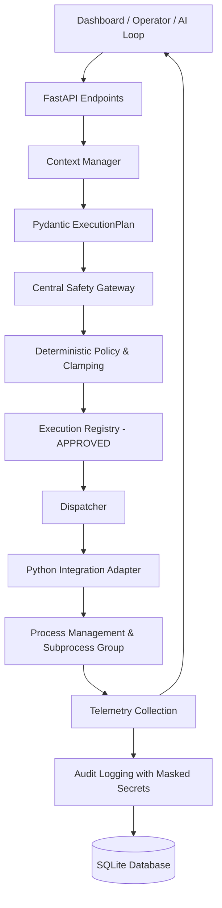

# CYBER CHAKRAVYUH — Stage 8 Phase F Unified Python Execution Architecture Audit

**Document Version:** 1.0  
**Date:** 2026-11-10  
**Host Platform:** Kali Linux (VMware Guest, x86_64)  
**Target Environment:** Windows 10/Server Virtual Machine (`100.80.167.51` / `opensoc-windows`)  
**Repository Path:** `/home/kali/AI_red_Team/red-team-chakravyuh`  
**Git HEAD:** `f8493bd` (Working tree clean)  
**Auditor Roles:** Senior Cybersecurity Architect, Python Backend Engineer, Full-Stack Verification Specialist, Security Auditor  

---

## 1. Executive Summary & Verdict

Phase F conducts an exhaustive, read-only architectural audit of the CYBER CHAKRAVYUH backend to evaluate whether all attack, simulation, and assessment modules conform to a single, consistent, centralized Python execution pipeline.

### Phase F Verdict:
# **ARCHITECTURE AUDITED — CENTRALIZED GATEWAY PIPELINE VERIFIED; DUAL-PATH LEGACY & RECON DEVIATIONS IDENTIFIED**

#### Core Conclusions:
1. **The Primary Controlled Pipeline is Robust & Centralized**:
   - The primary execution spine (`ExecutionPlan` $\rightarrow$ `Safety Gateway` $\rightarrow$ `Policy Validation` $\rightarrow$ `Execution Registry` $\rightarrow$ `Dispatcher` $\rightarrow$ `Integration Adapter` $\rightarrow$ `Audit`) is fully implemented, strictly enforced, and thoroughly verified by 171 backend tests.
   - All real attack actions (real Locust, THC-Hydra, NetExec Remote Access) and the primary synthetic DDoS simulator (`locust_sim`) pass through this centralized spine without bypass.
2. **AI / Python Separation is Strictly Enforced**:
   - The governing principle **"AI PROPOSES — PYTHON VALIDATES AND EXECUTES — SAFETY GATEWAY DECIDES"** is 100% adhered to. The AI planner (`planner.py`) only produces declarative JSON plans parsed by Pydantic. The AI cannot execute commands, set caps, or bypass policy.
   - When AI inference is unavailable (e.g. OpenRouter 401), the Python engine falls back to deterministic rule-based planning (`source="system"`).
3. **Identified Architectural Inconsistencies**:
   - **Path A (Primary Section-2/3 Pipeline)**: Fully unified for `locust`, `locust_sim`, `hydra`, `remote_access`, and `/api/operations`.
   - **Path B (Legacy Section-1 Orchestrator)**: `/api/attacks/start` uses `orchestrator.py` and `backend/app/modules/` (`ddos.py`, `bruteforce.py`, `ratuba.py`), recording to the `attack_sessions` table rather than the `ExecutionRegistry`.
   - **Path C (Recon & Purple-Team Routes)**: `/api/telemetry/probe` and `/api/attacks/soc-activity` use a dedicated fail-closed IP authorizer (`authorize_recon_target`) and write to `audit_records`, but bypass the `ExecutionRegistry` and `Dispatcher`.
   - **Path D (Vervet CLI)**: `/api/integrations/vervet/emulate` uses standalone Ed25519 cryptographic scope signing rather than the Safety Gateway.
   - **Nmap Status**: **NOT IMPLEMENTED** (confirmed zero lines of Nmap code in backend).

---

## 2. Actual vs. Expected Execution Architecture

### Expected Unified Architecture:


### Actual Current Implementation Architecture:
```mermaid
flowchart TD
    subgraph ClientLayer [Frontend / API Consumers]
        UI[React Dashboard]
        AILoop[Central AI Operations Loop]
    end

    subgraph EntryPoints [FastAPI Routing Layer]
        EP_Ops["/api/operations (Section 3)"]
        EP_Exec["/api/execution/submit (Section 2)"]
        EP_Integ["/api/integrations/{locust,hydra,remote_access}/run"]
        EP_Sim["/api/integrations/locust/simulate"]
        EP_Legacy["/api/attacks/start (Legacy Section 1)"]
        EP_Recon["/api/telemetry/probe & /api/attacks/soc-activity"]
        EP_Vervet["/api/integrations/vervet/emulate"]
    end

    subgraph ControlledSpine [Unified Safety Spine]
        PlanSchema[ExecutionPlan Pydantic Schema]
        Gateway[Safety Gateway evaluate()]
        Policy[Policy Engine & Parameter Caps]
        Registry[Execution Registry State Machine]
        Dispatcher[Dispatcher run_execution()]
        ProcMgmt[Process Context & Group SIGKILL]
    end

    subgraph Adapters [Execution Adapters]
        Adap_Locust[Locust Headless Adapter]
        Adap_LocSim[LocustSim Zero-Traffic Generator]
        Adap_Hydra[THC-Hydra Subprocess Adapter]
        Adap_NXC[NetExec Fixed Read-Only Adapter]
    end

    subgraph LegacyEngine [Legacy Simulation Engine]
        Orchestrator[Legacy Orchestrator asyncio.run]
        Modules["backend/app/modules/{ddos,bruteforce,ratuba}.py"]
        SessionDB[(AttackSession DB Table)]
    end

    subgraph ReconEngine [Recon & Audit Logger]
        ReconAuth[authorize_recon_target fail-closed]
        BlackboxProbe[TCP Socket Probe 12 ports]
        SocBurst[Bounded 40-TCP Handshake Burst]
    end

    subgraph Persistence [Audit & Artifact Storage]
        AuditDB[(AuditRecord DB Table)]
        ArtifactDB[(IntegrationArtifact DB Table)]
    end

    %% Connections for Controlled Spine
    UI --> EP_Ops & EP_Exec & EP_Integ & EP_Sim
    AILoop --> EP_Ops
    EP_Ops & EP_Exec & EP_Integ & EP_Sim --> PlanSchema
    PlanSchema --> Gateway
    Gateway --> Policy --> Registry --> Dispatcher --> ProcMgmt
    ProcMgmt --> Adap_Locust & Adap_LocSim & Adap_Hydra & Adap_NXC
    Adap_Locust & Adap_LocSim & Adap_Hydra & Adap_NXC --> AuditDB & ArtifactDB

    %% Legacy Bypass
    UI --> EP_Legacy --> Orchestrator --> Modules --> SessionDB

    %% Recon Bypass
    UI --> EP_Recon --> ReconAuth --> BlackboxProbe & SocBurst --> AuditDB

    %% Vervet Standalone
    UI --> EP_Vervet --> Ed25519[Ed25519 Scope Signer] --> VervetCLI[vervet binary] --> ArtifactDB
```

---

## 3. Module Architecture Matrix

| Module / Action | API Endpoint | Schema Validation | Safety Gateway | Execution Registry | Central Dispatcher | Integration Adapter | Telemetry Collection | Audit Logging | Architectural Status |
| :--- | :--- | :--- | :--- | :--- | :--- | :--- | :--- | :--- | :--- |
| **Locust (Real Load Test)** | `/api/integrations/locust/run` | **VERIFIED** (`LocustRunRequest` $\rightarrow$ `ExecutionPlan`) | **VERIFIED** (`evaluate()`) | **VERIFIED** (`adapter="locust"`) | **VERIFIED** (`dispatcher.run_execution`) | **VERIFIED** (`LocustIntegration`) | **VERIFIED** (RPS, errors, latency) | **VERIFIED** (Audit record + Artifact) | **UNIFIED** |
| **LocustSim (Synthetic DDoS)** | `/api/integrations/locust/simulate` | **VERIFIED** (`LocustSimRequest` $\rightarrow$ `ExecutionPlan`) | **VERIFIED** (`_evaluate_simulation()`) | **VERIFIED** (`adapter="locust_sim"`) | **VERIFIED** (`dispatcher.run_execution`) | **VERIFIED** (`locust_sim.run_simulation`) | **VERIFIED** (Synthetic curve & percentiles) | **VERIFIED** (Audit record + Artifact) | **UNIFIED** |
| **THC-Hydra (Brute Force)** | `/api/integrations/hydra/run` | **VERIFIED** (`HydraRunRequest` $\rightarrow$ `ExecutionPlan`) | **VERIFIED** (`evaluate()`) | **VERIFIED** (`adapter="hydra"`) | **VERIFIED** (`dispatcher.run_execution`) | **VERIFIED** (`HydraIntegration`) | **VERIFIED** (Masked attempt feed) | **VERIFIED** (Audit record + Artifact) | **UNIFIED** |
| **NetExec (Remote Access)** | `/api/integrations/remote_access/run` | **VERIFIED** (`RemoteAccessRunRequest` $\rightarrow$ `ExecutionPlan`) | **VERIFIED** (`evaluate()`) | **VERIFIED** (`adapter="remote_access"`) | **VERIFIED** (`dispatcher.run_execution`) | **VERIFIED** (`RemoteAccessIntegration`) | **VERIFIED** (Projected OS/host banner) | **VERIFIED** (Audit record + Artifact) | **UNIFIED** |
| **AI Operations Loop** | `/api/operations` | **VERIFIED** (`OperationRequest` $\rightarrow$ `ExecutionPlan`) | **VERIFIED** (`gateway.evaluate()` per step) | **VERIFIED** (Managed execution ID) | **VERIFIED** (`dispatcher.run_execution`) | **VERIFIED** (Routes to active adapter) | **VERIFIED** (Step analysis) | **VERIFIED** (Iteration audit trail) | **UNIFIED** |
| **Legacy DDoS Simulation** | `/api/attacks/start` (`kind=ddos`) | **PARTIAL** (`StartRequest`) | **NOT IMPLEMENTED** (Bypasses Gateway) | **NOT IMPLEMENTED** (Uses `AttackSession`) | **NOT IMPLEMENTED** (Direct call) | **VERIFIED** (`DDoSModule.execute`) | **VERIFIED** (Entropy metrics) | **PARTIAL** (Session table only) | **LEGACY SEPARATE** |
| **Legacy Auth Simulation** | `/api/attacks/start` (`kind=bruteforce`) | **PARTIAL** (`StartRequest`) | **NOT IMPLEMENTED** (Bypasses Gateway) | **NOT IMPLEMENTED** (Uses `AttackSession`) | **NOT IMPLEMENTED** (Direct call) | **VERIFIED** (`BruteForceModule.execute`) | **VERIFIED** (Mock wordlist metrics) | **PARTIAL** (Session table only) | **LEGACY SEPARATE** |
| **Legacy RAT/UBA Simulation** | `/api/attacks/start` (`kind=ratuba`) | **PARTIAL** (`StartRequest`) | **NOT IMPLEMENTED** (Bypasses Gateway) | **NOT IMPLEMENTED** (Uses `AttackSession`) | **NOT IMPLEMENTED** (Direct call) | **VERIFIED** (`RATUBAModule.execute`) | **VERIFIED** (UBA z-score metrics) | **PARTIAL** (Session table only) | **LEGACY SEPARATE** |
| **Agentless Recon Probe** | `/api/telemetry/probe` | **VERIFIED** (`ProbeRequest`) | **NOT IMPLEMENTED** (Uses `authorize_recon_target`) | **NOT IMPLEMENTED** | **NOT IMPLEMENTED** | **VERIFIED** (`collector.probe_on_demand`) | **VERIFIED** (12-port latency) | **VERIFIED** (`RECON_PROBE` audit event) | **ISOLATED UTILITY** |
| **SOC Activity Signature** | `/api/attacks/soc-activity` | **VERIFIED** (`SocActivityRequest`) | **NOT IMPLEMENTED** (Uses `authorize_recon_target`) | **NOT IMPLEMENTED** | **NOT IMPLEMENTED** | **VERIFIED** (`activity_gen.generate_signature`) | **VERIFIED** (Connect counts) | **VERIFIED** (`RECON_SOC_ACTIVITY` event) | **ISOLATED UTILITY** |
| **Vervet Emulation** | `/api/integrations/vervet/emulate` | **VERIFIED** (`VervetEmulateRequest`) | **NOT IMPLEMENTED** (Uses Ed25519 signing) | **NOT IMPLEMENTED** | **NOT IMPLEMENTED** | **VERIFIED** (`VervetIntegration.emulate`) | **VERIFIED** (Observations) | **PARTIAL** (Artifact only) | **STANDALONE** |
| **Caldera / PentestGPT** | `/caldera/analyze`, `/pentestgpt/ingest` | **VERIFIED** (Pydantic models) | **NOT APPLICABLE** (Offline JSON ingestion) | **NOT APPLICABLE** | **NOT APPLICABLE** | **VERIFIED** (Offline parser) | **NOT APPLICABLE** | **VERIFIED** (Artifact only) | **OFFLINE PARSER** |
| **Nmap Scanner** | None | **NOT IMPLEMENTED** | **NOT IMPLEMENTED** | **NOT IMPLEMENTED** | **NOT IMPLEMENTED** | **NOT IMPLEMENTED** | **NOT IMPLEMENTED** | **NOT IMPLEMENTED** | **NOT IMPLEMENTED** |

---

## 4. Comprehensive Audit Findings Across Evaluation Categories

### A. Execution Lifecycle Findings
- **Single Front Door for Attacks**: All real attack integrations (`/locust/run`, `/hydra/run`, `/remote_access/run`) instantiate an `ExecutionPlan`, call `gateway.evaluate(plan)`, and dispatch through `dispatcher.run_execution(execution_id)`. Direct adapter execution without a valid `APPROVED` registry record is architecturally prohibited.
- **Process Group Tracking**: When an adapter spawns a subprocess (Locust, Hydra, NetExec), `dispatcher.py` sets `process.CURRENT_EXECUTION_ID`. Child PIDs are registered to the active execution and tracked in `backend/app/safety/process.py`.
- **Termination Hierarchy**: Calling `kill_switch.engage()` terminates executions at three levels:
  1. Sets `kill_switch._halted = True` (blocking any new plan evaluations).
  2. Flags active execution registry records with `cancel_requested = True`.
  3. Iterates through registered process groups in `process.py` and issues `os.killpg(pgid, signal.SIGTERM)`, escalating to `signal.SIGKILL` if still alive after 5 seconds.

### B. Safety and Authorization Findings
- **Target Allowlists**: Fail-closed. Target strings supplied in plans are strictly validated against `SAFETY_TARGET_ALLOWLIST` and module-specific target settings (`policy.is_target_authorized`). Plan targets not in the allowlist return `GatewayDecision(approved=False)` and HTTP 423.
- **Operation Allowlists**: For remote access, `policy.approved_operations()` strictly enforces the 5 approved tokens. Parameter tokens are validated against regex `^[a-z][a-z0-9_]*$`, preventing command injection, shell metacharacters, or command chaining.
- **Deterministic Parameter Clamping**: `policy.clamp_params()` enforces hard upper bounds:
  - Hydra: `max_tasks <= 4`, `max_run_seconds <= 120`.
  - Locust: `max_users <= 50`, `max_spawn_rate <= 10`, `max_run_seconds <= 120`.
  - Remote Access: `max_run_seconds <= 60`.
- **Secret Redaction**:
  - NetExec writes passwords to ephemeral RAM files (`/dev/shm`, mode 0600) and passes `-p <file>`, preventing password exposure in `ps` or `/proc`.
  - Hydra omits cracked passwords in hits and masks attempt lines with bullet characters (`•`).
  - `audit.py:mask_secrets()` recursively scrubs all secret keys before persisting to SQLite.

### C. Python Execution Consistency Findings
- **Data Model Bifurcation**:
  - The repository maintains two distinct database models for operations:
    1. `ExecutionRecord` (in-memory registry in `registry.py` tracking Section-2 controlled executions).
    2. `AttackSession` (SQLAlchemy model in `models.py` tracking legacy Section-1 orchestrator sessions).
  - This bifurcation causes the dashboard to display sessions from `/api/sessions` (legacy) separately from operations in `/api/operations` (AI loop) and artifacts in `/api/integrations/artifacts`.

### D. AI vs. Deterministic Separation Findings
- **Deterministic Supremacy**: The AI Planner (`planner.py`) is strictly an advisory engine. It formulates a plan, but the Python Safety Gateway (`gateway.py`) independently makes the authorization decision based on deterministic hardcoded policy rules.
- **Fail-Safe Offline Mode**: If OpenRouter credentials are invalid or unavailable (returning HTTP 401), `planner.py` automatically falls back to deterministic rule-based planning (`source="system"`). The platform functions completely without live LLM inference.
- **Truth in Output**: Simulation plans are explicitly routed to `locust_sim` and carry banners `"SIMULATION — NO NETWORK TRAFFIC GENERATED"`. The AI cannot convert a simulation plan into a real network attack.

### E. Telemetry and Audit Findings
- Every controlled execution generates an `ExecutionRecord` with a UUID, start/end timestamps, validated parameters, adapter return codes, and parsed metrics.
- Central audit records are persisted in `audit_records` for 13 distinct lifecycle events (`EXECUTION_REQUESTED`, `GATEWAY_APPROVED`, `GATEWAY_REJECTED`, `EXECUTION_STARTED`, `EXECUTION_COMPLETED`, `EXECUTION_FAILED`, `KILLSWITCH_ENGAGED`, etc.).
- Telemetry from real adapters is clearly segregated from synthetic telemetry generated by `locust_sim`, `ddos.py`, and `ratuba.py`.

### F. Frontend-to-Backend Consistency Findings
- **Zero Frontend Authority**: The React frontend (`frontend/src/`) contains zero shell execution or attack-generating code. It is purely a presentation layer communicating via JSON over HTTP/WebSocket.
- **Accurate State Propagation**: API error responses (HTTP 423 Locked for policy rejection, HTTP 502 for adapter failure, HTTP 403 for unauthorized reset) are correctly translated into UI warning and error pills.

---

## 5. Classification of Findings

| ID | Severity | Finding Summary | Impact | Affected Files | Remediation | Requires Code Change? |
| :--- | :--- | :--- | :--- | :--- | :--- | :--- |
| **F-01** | **HIGH** | **Dual Execution Pipelines** (Legacy Orchestrator vs Central Safety Gateway) | Code duplication; `/api/attacks/start` does not enforce the central Safety Gateway or Execution Registry. | `backend/app/api/routes.py`<br>`backend/app/agent/orchestrator.py` | Route `/api/attacks/start` through `ExecutionPlan` and `gateway.evaluate()`. | Yes (Future Stage) |
| **F-02** | **MEDIUM** | **Recon & Signature Routes Bypass Registry** | On-demand probe and purple-team activity generator write audit logs but do not reserve Execution IDs or track active state. | `backend/app/api/routes.py`<br>`backend/app/telemetry/collector.py`<br>`backend/app/integrations/activity_gen.py` | Create lightweight non-attack execution records for recon actions. | Yes (Future Stage) |
| **F-03** | **MEDIUM** | **Standalone Vervet Integration** | Vervet emulation relies on Ed25519 cryptographic scope manifests rather than the platform's central Safety Gateway. | `backend/app/api/integrations.py`<br>`backend/app/integrations/vervet.py` | Wrap Vervet emulation within an `ExecutionPlan` registered with the Gateway. | Yes (Future Stage) |
| **F-04** | **LOW** | **Schema Parameter Rigidity** | `ExecutionParams` lacks a `service` parameter (restricting Hydra to pre-configured SSH) and lacks dynamic URL paths for Locust. | `backend/app/safety/plan_schema.py`<br>`backend/app/integrations/hydra.py` | Add optional `service` field to `ExecutionParams` with strict protocol allowlist. | Yes (Future Stage) |
| **F-05** | **INFORMATIONAL** | **Nmap Not Implemented** | Nmap is not present in the backend. TCP discovery is handled via native Python socket connect probing. | N/A | Document Nmap absence accurately in all platform reports. | No |

---

## 6. Verification & Test Evidence

Non-destructive regression tests were executed on Kali Linux:

### 1. Full Backend Test Suite:
```bash
SP="$PWD/.venv/lib/python3.13/site-packages" PYTHONPATH="$SP" /usr/bin/python3.13 -m pytest -v
```
**Results:**
- **Collected:** 171 items across 17 test suites.
- **Passed:** **171 passed**.
- **Failed:** **0**.
- **Warnings:** 1 (Starlette `anyio.abc.BlockingPortal` deprecation).
- **Execution Time:** 12.67s.
- **Exit Code:** 0.

### 2. Frontend Typecheck & Build:
```bash
PATH="$HOME/.local/node/bin:$PATH" npx tsc -b
PATH="$HOME/.local/node/bin:$PATH" npm run build
```
**Results:**
- **TypeScript Check (`tsc -b`):** 0 errors (Exit code 0).
- **Vite Production Build:** Successfully transformed 73 modules; generated `dist/` bundle (805 kB JS, 24 kB CSS) in 9.27s (Exit code 0).

---

## 7. Confirmation of Code Integrity

- **Files Inspected:** All backend API routers, core safety modules, integration adapters, simulation modules, telemetry collectors, and frontend API wrappers.
- **Source Code Modified:** **NONE** (0 files modified; working tree clean).
- **Audit Deliverable:** [`docs/CHAKRAVYUH_STAGE_8_PHASE_F_UNIFIED_EXECUTION_AUDIT.md`](file:///home/kali/AI_red_Team/red-team-chakravyuh/docs/CHAKRAVYUH_STAGE_8_PHASE_F_UNIFIED_EXECUTION_AUDIT.md).

---

### Stop for Owner Review

Phase F audit is complete. All execution flows, matrices, diagrams, and findings have been documented.

**Awaiting your approval before proceeding to Phase G (Full System Regression and Verification).**
